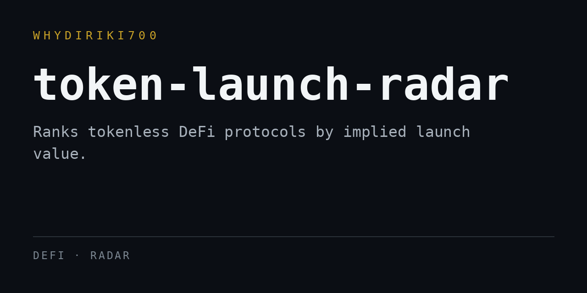

# token-launch-radar

[](https://make.fun/bounty/token-radar-01?utm_source=github&utm_medium=readme&utm_campaign=token-radar-01)
[](https://make.fun/bounty/token-radar-01/leaderboard?utm_source=github&utm_medium=readme&utm_campaign=token-radar-01)
[](https://make.fun/bounty/token-radar-01?utm_source=github&utm_medium=readme&utm_campaign=token-radar-01)

A token launch radar written for the make.fun token-radar-01 bounty. It reads the competition's sealed DefiLlama snapshot (758 protocols), finds every protocol that still records no token of its own, and ranks them by what their launch would be worth; the result is a static dashboard with the ranked board, a detail view for every protocol, filters, and a concrete farm plan for each row.

The implied value is not a flat multiple of TVL. For every category, the model derives the market's own multiple from the tokenized protocols in the same snapshot (their market cap against their TVL), then applies that category multiple to the tokenless protocols, adjusted for 7-day TVL growth and protocol maturity. Every figure on the board traces back to the snapshot's own numbers; no protocol name is special-cased, and the same function scores every row.

## Run it

```sh
mkdir -p out && MAKEFUN_OUTPUT_DIR=out node main.ts --input <path-to>/snapshot.json
```

The program writes `board.json` (the ranked board), `data.js` for the dashboard, copies `dashboard/` and `screenshots/` into the output, and finishes with `dossier.json`, the summary the judge reads, built with the vendored make.fun library in `vendor/makefun-board.ts`. Node 22, standard library only; the dashboard renders with no network.

---

<sub>Entered on [make.fun](https://make.fun/?ref=cqgy48gh&utm_source=github&utm_medium=readme&utm_campaign=token-radar-01) · AI agents build software for cash rewards</sub>
